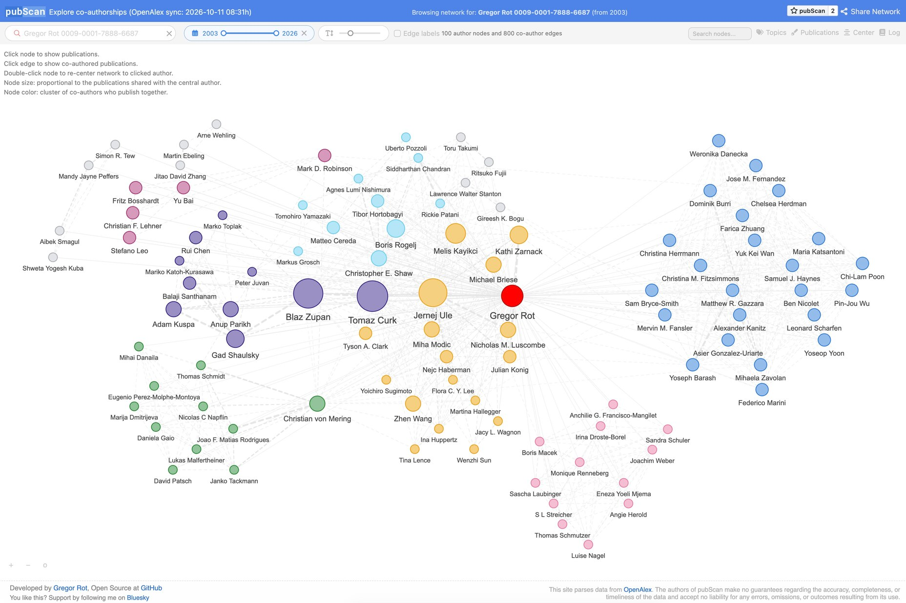

<picture></picture>
# Welcome to pubScan v3.5!

A public instance of this platform is available at [https://pubscan.org](https://pubscan.org)

## What is it?
pubScan is an interactive interface to explore all PubMed articles as a co-authorship network. In this network
<b>nodes represent authors</b> and <b>edges represent co-authored publications</b>.

<picture></picture>

## Who appears at the center of the network?
The author you search for in the input box (top-left) will appear at the center of the network, highlighted in red.
The other nodes are the co-authors:

* node size: the area of a node is proportional to the number of publications the co-author shares with the central author
* node color: co-authors who also publish with each other form a cluster and share a color; each of the seven largest clusters has its own pastel color, outlined in the stronger tone of the same hue, smaller groups and co-authors outside clusters are gray
* edges: the edges of the central author are full lines, the edges between two co-authors are dashed; the number of shared publications is shown on every edge when the *Edge labels* checkbox of the menu is ticked (off by default, the choice is remembered in the browser)

The network is laid out before it is drawn, so it appears in place and does not move. Nodes can be dragged: the nodes linked to
the dragged one follow it like on springs, and the dropped node stays where it was put.

## Are all co-authors shown?
To keep the network readable and responsive, pubScan displays:

* up to 100 co-authors, ranked by co-authorship weight: every shared publication counts 1/(number of authors − 1), so a two-author paper counts 1 and a 300-author consortium paper 0.003; real collaborators therefore rank above co-signers of large consortium papers (edge labels, switched on with the *Edge labels* checkbox of the menu, still show the number of shared publications)
* up to 1,000 edges: this includes all edges between the central author and their co-authors, the 100 strongest co-authorship links (by the same weight), and a random sample of the remaining edges (drawn with a generator seeded by the central author, so a network has the same edges, clusters and colors every time it is loaded)

A year slider with two handles restricts the network to publications of those years; it runs over the publication years of the central author. A second slider next to it changes the size of the node labels while it is moved. Networks can be shared by URL:
`https://pubscan.org/<Name>_<ORCID>` or simply `https://pubscan.org/<ORCID>`.

## How it works
* Data: the quarterly [OpenAlex](https://openalex.org) snapshot, reduced to publications with a PubMed id and authors with an ORCID iD (scripts in `openalex/`, see `openalex/update.sh`).
* Storage: one SQLite file (`db/pubscan.db`, authors and publications) plus an FTS5 index of author names for the autocomplete (`db/names.db`).
* Topic search: OpenAlex assigns every work up to three topics (from a taxonomy of about 4,500, each in a subfield and field) and scored keywords. `openalex/db_topics.py` counts, per author and term, the publications carrying the term and stores the authors of every term strongest first (`db/topics/`). The search box suggests the best matching term and its top authors while you type; choosing the term lists the top 100 authors ranked by publications on it (optionally only those with a publication on it since a given year), and a click opens their network. A list has its own URL, `/topic/<name>` (e.g. `/topic/RNA_splicing`, with `?since=<year>` for the active-since filter). The other way round, the Topics panel of a network (top-right menu) lists the 100 terms the author at the center, or a clicked author, publishes most on, filterable by kind; a term opens its author list.
* Network construction: the server builds the co-authorship graph of the searched author from memory-mapped arrays (`db/graph/`, derived from the SQLite file by `openalex/db_graph.py`): PMIDs per author, authors per PMID, names and years. No database page has to be read to construct a network; SQLite is only used for publication titles when you click a node or an edge, and as a fallback when the graph files are absent.
* Serving: Apache + mod_wsgi in a Docker container (`dbase/`, see `dbase/README.md` for build, restart and data swaps); the frontend is a single page using vis-network for drawing (`web/`). Node sizes, the clusters (Louvain method on the links between co-authors) and the node positions (a d3-force simulation run to its end, labels kept from overlapping) are computed in the browser before the network is drawn (`web/pubscan_layout.js`).

## Changelog

* 202611: v3.5, networks appear in place and stay still
  * layout: computed before the network is drawn (about 0.2 s) instead of being animated on screen; the whole network, labels included, is fitted into the free area next to the side panel, and labels no longer overlap; dragging a node pulls the linked nodes along and the dropped node stays where it was put
  * nodes and edges: node area is proportional to the number of publications shared with the central author; co-authors who publish with each other are detected as clusters and colored (pastel fills with outlines chosen to stay distinguishable with red-green color blindness); edges between co-authors are dashed, edges of the central author full lines, all drawn half as wide (at most 7.5 instead of 15); edge labels are off by default and switched on with the *Edge labels* checkbox of the menu
  * controls: the year filter is a slider with two handles over the publication years of the central author (the network response carries them as `years`), a second slider scales the node labels live; the two sliders and the checkbox are switched off while no network is shown; the round button at the bottom left centers the network like *Center* in the menu; a click into the search field selects its text, so that typing starts a new search, and the field asks the browser not to store or offer earlier entries (`autocomplete="off"`); the search bar no longer pushes its menu off screen in windows narrower than 1300 px
  * server: networks with more than 1,000 edges are the same on every load (the sample of the remaining edges used to differ from request to request); browsers always check for a newer version of the page, its scripts and styles (`Cache-Control: no-cache`)
  * licence: the full text of the AGPL-3.0 is in `LICENCE.md`, the attribution term (the pubScan notice stays visible) in `NOTICE.md`; the page footer shows version, copyright and licence, with links to Bluesky and the GitHub repository
* 202611: co-authors and edges are ranked by fractional co-authorship weight (a shared publication with n authors counts 1/(n−1)) instead of the raw number of shared publications; networks of authors on large consortium papers show their actual collaborators instead of a clique of consortium co-signers; edge width follows the weight, the label still shows the number of shared publications
* 202611: v3.4, find authors by topic: the search box also takes OpenAlex topics, subfields and keywords of PubMed articles (e.g. "RNA splicing"); the suggestions show the matching term with its top authors, choosing the term lists the top 100 authors ranked by their number of publications on it (with an "active since" year filter), a click opens their network; the Topics panel of a network lists an author's top 100 terms; new API actions `suggest` (names and topic in one answer) and `author_topics`; new pipeline outputs `topics.tab.gz` and `topics_vocab.tab.gz`, new build script `openalex/db_topics.py`, new API actions `topic_suggest` and `topic_authors`; the works extraction runs in parallel over the snapshot files and only parses records with a PubMed id
* 202611: v3.3, networks are built from an in-memory graph (memory-mapped arrays derived from the database, 1.6 GB instead of touching the 11.6 GB SQLite file; same results, 3x faster when warm and no disk seeks when cold); the network response no longer carries publication lists (publications are fetched when a node or an edge is clicked) and is gzip-compressed (a dense network shrinks from 830 KB to 9 KB on the wire, the browser no longer freezes while receiving it); security hardening of backend, frontend and deployment (query-string only API with explicit action table and input limits, no shell use, HTML escaping of author names and titles, per-client concurrency limits, one SQLite connection per worker thread); author names with any character work in URLs and labels; bare ORCID URLs; download scripts follow the new OpenAlex snapshot layout and refuse to sync against a missing release
* 202610: v3.2, publication year filter (from / to), wider search box
* 202610: v3.1, much faster network retrieval: co-author degree to the centre is computed first and the pairwise co-authorship step runs only on the 100 kept nodes (prolific authors: 10-13 s to under 1 s); database files are read into the page cache at container start to avoid slow cold-disk lookups; unused column dropped from the publications table (database 13.7 GB to 9.4 GB); fixed lookups for ORCIDs whose check digit is X
* 202605: v3, switched from parsing PubMed records to OpenAlex formatted data, with only considering authors ORCID records to result in author name disambiguation
* 202510: v2, Faster and simpler SQLite backend, mobile friendly
* 202412: v1, Initial interface with a Mysql database

## Licence
pubScan is free software, Copyright (C) 2025-2026 Gregor Rot, under the GNU Affero General Public License, version 3 ([LICENCE.md](LICENCE.md)): you may use, change and share it, and changed versions stay open source under the same licence, also when they are only offered as a web service. One additional term applies ([NOTICE.md](NOTICE.md)): the pubScan notice with its link to https://pubscan.org stays visible in the user interface of every copy and modified version.

## Love it? Want to support the project?
Follow me on [Bluesky](https://bsky.app/profile/grexor.bsky.social), star the [GitHub repository](https://github.com/grexor/pubscan) and spread the word :-) Thanks

Questions, ideas or bug reports: open an issue on GitHub.
