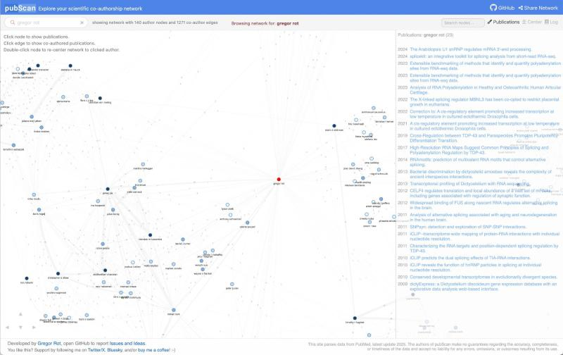

<picture></picture>
# Welcome to pubScan v3.4!

A public instance of this platform is available at [https://pubscan.org](https://pubscan.org)

## What is it?
pubScan is an interactive interface to explore all PubMed articles as a co-authorship network. In this network
<b>nodes represent authors</b> and <b>edges represent co-authored publications</b>.

<picture></picture>

## Who appears at the center of the network?
The author you search for in the input box (top-left) will appear at the center of the network, highlighted in red.
Other nodes are colored based on the number of publications for the author in PubMed:
 < 10 publications,  10-50 publications,  50-100 publications,  > 100 publications

## Are all co-authors shown?
To keep the network readable and responsive, pubScan displays:

* up to 100 co-authors (ranked by number of shared publications)
* up to 1,000 edges: this includes all edges between the central author and their co-authors, the 100 strongest co-authorship links, and a random sample of the remaining edges

An optional year range (from / to) restricts the network to publications of those years. Networks can be shared by URL:
`https://pubscan.org/<Name>_<ORCID>` or simply `https://pubscan.org/<ORCID>`.

## How it works
* Data: the quarterly [OpenAlex](https://openalex.org) snapshot, reduced to publications with a PubMed id and authors with an ORCID iD (scripts in `openalex/`, see `openalex/update.sh`).
* Storage: one SQLite file (`db/pubscan.db`, authors and publications) plus an FTS5 index of author names for the autocomplete (`db/names.db`).
* Topic search: OpenAlex assigns every work up to three topics (from a taxonomy of about 4,500, each in a subfield and field) and scored keywords. `openalex/db_topics.py` counts, per author and term, the publications carrying the term and stores the authors of every term strongest first (`db/topics/`). The search box suggests the best matching term and its top authors while you type; choosing the term lists the top 100 authors ranked by publications on it (optionally only those with a publication on it since a given year), and a click opens their network. A list has its own URL, `/topic/<name>` (e.g. `/topic/RNA_splicing`, with `?since=<year>` for the active-since filter).
* Network construction: the server builds the co-authorship graph of the searched author from memory-mapped arrays (`db/graph/`, derived from the SQLite file by `openalex/db_graph.py`): PMIDs per author, authors per PMID, names and years. No database page has to be read to construct a network; SQLite is only used for publication titles when you click a node or an edge, and as a fallback when the graph files are absent.
* Serving: Apache + mod_wsgi in a Docker container (`dbase/`, see `dbase/README.md` for build, restart and data swaps); the frontend is a single page using vis-network (`web/`).

## Changelog

* 202611: v3.4, find authors by topic: the search box also takes OpenAlex topics, subfields and keywords of PubMed articles (e.g. "RNA splicing"); the suggestions show the matching term with its top authors, choosing the term lists the top 100 authors ranked by their number of publications on it (with an "active since" year filter), a click opens their network; new API action `suggest` (names and topic in one answer); new pipeline outputs `topics.tab.gz` and `topics_vocab.tab.gz`, new build script `openalex/db_topics.py`, new API actions `topic_suggest` and `topic_authors`; the works extraction runs in parallel over the snapshot files and only parses records with a PubMed id
* 202611: v3.3, networks are built from an in-memory graph (memory-mapped arrays derived from the database, 1.6 GB instead of touching the 11.6 GB SQLite file; same results, 3x faster when warm and no disk seeks when cold); the network response no longer carries publication lists (publications are fetched when a node or an edge is clicked) and is gzip-compressed (a dense network shrinks from 830 KB to 9 KB on the wire, the browser no longer freezes while receiving it); security hardening of backend, frontend and deployment (query-string only API with explicit action table and input limits, no shell use, HTML escaping of author names and titles, per-client concurrency limits, one SQLite connection per worker thread); author names with any character work in URLs and labels; bare ORCID URLs; download scripts follow the new OpenAlex snapshot layout and refuse to sync against a missing release
* 202610: v3.2, publication year filter (from / to), wider search box
* 202610: v3.1, much faster network retrieval: co-author degree to the centre is computed first and the pairwise co-authorship step runs only on the 100 kept nodes (prolific authors: 10-13 s to under 1 s); database files are read into the page cache at container start to avoid slow cold-disk lookups; unused column dropped from the publications table (database 13.7 GB to 9.4 GB); fixed lookups for ORCIDs whose check digit is X
* 202605: v3, switched from parsing PubMed records to OpenAlex formatted data, with only considering authors ORCID records to result in author name disambiguation
* 202510: v2, Faster and simpler SQLite backend, mobile friendly
* 202412: v1, Initial interface with a Mysql database

## Love it? Want to support the project?
Star it and spread the word :-) Thanks

Questions, ideas or bug reports: open an issue on GitHub.
